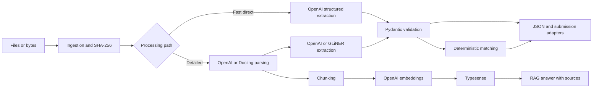

# Hackathon Document Intelligence Toolkit

## Atira RFQ challenge agent

The repository now includes a model-directed browser agent for the RFQ challenge,
with evidence tracking, Decimal pricing, unit tests and a sandbox package manifest.
See [the RFQ implementation guide](docs/RFQ_AGENT.md) for installation, practice runs,
architecture, supported rules, limitations and prioritized improvements. Live challenge
performance has not yet been measured.

```bash
uv venv .venv
uv pip install --python .venv/bin/python -e '.[test,rfq]'
.venv/bin/python -m pytest -q
.venv/bin/python scripts/package_rfq.py
```

## General-purpose toolkit

A small Python toolkit for schema-based document extraction, deterministic requirement matching, optional Typesense retrieval, and deadline-aware simulation. It is designed for adapting to an unknown document challenge, not for a particular competition API.

## Install

Requires Python 3.11+. From this directory:

```bash
python3 -m venv .venv
.venv/bin/python -m pip install -e '.[test,api,llm,matching]'
cp .env.example .env
```

Set `OPENAI_API_KEY` in `.env`, then load it in your shell with `set -a; source .env; set +a`. Keep `.env` private. The default extraction path sends source documents to OpenAI. The parser and extraction model are configurable with `OPENAI_PARSER_MODEL` and `OPENAI_EXTRACTION_MODEL`. Confirm your account has access to the chosen model.

## Four demonstrations

**A. Document to JSON, one OpenAI request**

```bash
hackkit extract examples/documents/technical_spec.txt --schema examples/schemas/simple_technical.json
```

Add `--parse-first` to do LLM parsing followed by extraction. Direct extraction is the faster default when only a specific JSON output is needed. `hackkit parse examples/documents/technical_spec.txt` shows the normalized document representation.

For CSV and XLSX, use `--parser tabular --parse-first` to read every row locally before LLM extraction. The parser streams CSV rows and reads XLSX sheets with openpyxl in read-only mode. `TABULAR_ROWS_PER_TABLE` controls the row batches in the normalized output. Install `.[office]` for XLSX. Direct XLSX input is rejected, and direct CSV input rejects more than 1,000 rows, because the file-input preview can omit later rows. For very large spreadsheets, extract from individual table batches or use the local GLiNER path so the full sheet is not sent in one LLM request.

Parsing and extraction results are cached in `SQLITE_PATH` by content hash, backend/model, parser options, schema, instructions, and cache version. Set `ENABLE_CACHE=false` to disable this behavior. A cached OpenAI result can be read without an API key; a cache miss still needs the key.

**B. Offline extraction**

```bash
.venv/bin/python -m pip install -e '.[local]'
hackkit extract examples/documents/technical_spec.md --parser docling --backend gliner --schema technical
```

The first run downloads Docling and GLiNER model weights. Use a prepopulated local model cache when running without network access. GLiNER's entity mode works on string and string-list fields. For repeated flat records, call `GLiNERExtractionBackend.extract_records(parsed_document, RecordModel, "product")`; it uses GLiNER's record API, validates each record with Pydantic, and retains source spans. Arbitrarily nested RFQ structures still need another extractor. The offline path never calls OpenAI.

`--backend auto` selects GLiNER only when a local parser is selected, GLiNER is installed, and every schema field is a supported entity field. Otherwise it selects OpenAI extraction. Use explicit `--backend gliner` for documents that must remain local; `auto` can send parsed text to OpenAI.

**C. Requirement matching**

```bash
hackkit demo-rfq examples/documents/rfq.txt examples/documents/technical_spec.txt
hackkit match examples/matching.json
```

`demo-rfq` reads two sample text documents, normalizes their known field patterns, and produces an evidence-backed compliance report. The regex mapping is deliberately a sample workflow; use the extraction modules for unknown document layouts. `match` takes a structured JSON fixture. An `or_better` comparison needs an explicit hierarchy passed to `match_requirements`; the JSON CLI sample therefore marks the GPU preference as unknown unless a hierarchy is supplied in Python. Mandatory failures cannot be hidden by the optional score.

`normalize_requirement(text, attribute)` handles a small set of explicit phrases such as “at least”, “no more than”, and “between”. Ambiguous language raises an error for review or LLM normalization.

**D. Continuous processing simulation**

```bash
hackkit simulate --format markdown
hackkit benchmark --format json
```

The simulation uses mocked async workers and real elapsed time, with concurrent arrivals, burst pressure, failures, and deadlines. Results vary by machine. It is a scheduling benchmark, not an extraction accuracy benchmark.

To process files continuously, create an input directory and run:

```bash
mkdir -p inbox
hackkit run-worker inbox --schema technical --output results
```

Drop completed files into `inbox` by atomic rename. The watcher waits for stable size and modification time, assigns each document a UTC deadline, and writes results to `results/`. Job state is persisted in `SQLITE_PATH` and unfinished jobs can be recovered on restart. Use `--parser docling --backend gliner` for the local path.

`compare_extraction_backends` accepts real or mocked backend objects and labeled `LabeledCase` items. It computes precision, recall, F1, exact match, and measured latency. `synthetic_extraction_cases(seed=42)` provides reproducible English and German starter cases; benchmark real challenge data before trusting accuracy numbers.

OpenAI extraction records input and output token counts, and embeddings record token usage. `estimate_cost_usd` calculates a cost from those measured counts and rates you supply for the current model; no prices are hardcoded.

With an OpenAI key and local GLiNER weights installed, run `hackkit benchmark-backends --count 20 --format markdown` to measure both extraction backends on the synthetic starter set. This is a live comparison and incurs OpenAI API usage.

## Retrieval and Q&A

Typesense is optional. Set a strong `TYPESENSE_API_KEY` in the shell and run:

```bash
docker compose up -d
hackkit index examples/documents/technical_spec.txt
hackkit search 'industrial workstation memory' --mode hybrid
hackkit ask 'Which workstation has 64 GB RAM?'
```

Indexing uses OpenAI `text-embedding-3-small`, default 1536 dimensions. Query embeddings must use the same model and dimensions. Change `TYPESENSE_COLLECTION` and reindex if the model or dimensions change. Keyword search needs no embedding request. Hybrid search sends a query embedding to OpenAI and passes an external vector to Typesense. Indexing and query embeddings share the SQLite cache when `ENABLE_CACHE=true`; identical texts within a batch are sent once. Embedding requests run in bounded concurrent batches with timeout and transient error retries.

## Python usage

The toolkit can be installed with `pip install -e .` and imported from any Python
project. See [LIBRARY_USAGE.md](LIBRARY_USAGE.md) for each public component and a
complete offline challenge pipeline, and [LIBRARY_AUDIT.md](LIBRARY_AUDIT.md) for
the library audit. The base dependency is Pydantic; add `llm`, `search`, `http`,
`matching`, `api`, `local`, or `office` extras for the integrations you use.

```python
import asyncio
from hackathon_toolkit.ingestion import ingest_file
from hackathon_toolkit.extraction import OpenAIExtractionBackend
from hackathon_toolkit.schemas import TechnicalSpecification

async def main():
    doc = ingest_file('examples/documents/technical_spec.txt')
    result = await OpenAIExtractionBackend().extract(doc, TechnicalSpecification)
    print(result.model_dump_json(indent=2))

asyncio.run(main())
```

`Document`, `ParsedDocument`, `ExtractionResult`, `Constraint`, `DocumentChunk`, `ProcessingRequest`, and `ProcessingResult` are Pydantic models. `LLMDocumentParser`, `DoclingDocumentParser`, `TabularDocumentParser`, `GLiNERExtractionBackend`, `EmbeddingService`, `TypesenseSearch`, `run_workflow`, and `JobProcessor` have injectable dependencies for local tests. The optional FastAPI app exposes uploads, extraction, matching, search, Q&A, and queued jobs:

```bash
uvicorn hackathon_toolkit.api:create_app --factory --reload
curl --data-binary @examples/documents/technical_spec.txt 'http://localhost:8000/documents?filename=technical_spec.txt'
```

Use the returned document `id` in `POST /extract` with `{"document_id":"...","schema_name":"technical"}` or in `POST /jobs` for asynchronous processing. `GET /jobs/{job_id}` and `GET /jobs/{job_id}/results` report progress and output. The API accepts built-in schema names; use the CLI or Python interface for arbitrary JSON Schema files. Uploads use raw request bodies with a `filename` query parameter and have a configured size limit.

## Architecture



## Tests and limits

Run `.venv/bin/python -m pytest -q`. Unit tests require no credentials or running services. They use mocked API responses and local model objects. Live OpenAI, Docling model weights, and Typesense were not exercised in this environment. The Docling adapter preserves ordered sections, table rows, and page references when Docling exposes them; merged-cell semantics and coordinates are not yet retained. The GLiNER integration supports entities and repeated flat records with spans; arbitrary nested structures remain unsupported. Raw model scores are kept separately from deterministic validation and should not be interpreted as calibrated probabilities. The API uses a local upload directory and has no authentication, so it is intended for trusted local use. The scheduler persists JSON-serializable payloads, status, and results. HTTP submissions use an idempotency key and retries, but exact-once delivery depends on the receiving API honoring that key. Cost estimation needs task-specific pricing; accuracy evaluation needs labeled challenge data.

The OpenAI file path follows the [official file-input guide](https://developers.openai.com/api/docs/guides/file-inputs), and the Pydantic extraction path follows [Structured Outputs](https://developers.openai.com/api/docs/guides/structured-outputs). GLiNER calls follow the project's [entity](https://github.com/fastino-ai/GLiNER2/blob/main/tutorial/2-ner.md) and [record](https://github.com/fastino-ai/GLiNER2/blob/main/tutorial/3-json_extraction.md) tutorials. Hybrid search follows the [Typesense vector-search guide](https://typesense.org/docs/30.2/api/vector-search.html).
