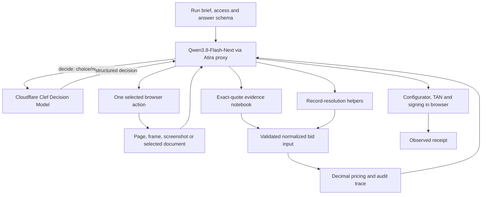

# RFQ agent implementation

This implementation targets the Atira RFQ **version 6** brief read on **2026-10-10**.
It provides a runnable model-directed browser agent, an evidence notebook, deterministic
record-resolution helpers, a Decimal pricing engine, tests, and a submission package builder.
Local unit and Chromium/CDP tests cover the submission gate, four independent sessions,
changed synthetic layouts and screenshot tracing. See `docs/RFQ_DIAGNOSIS.md` for live results.

The live run brief and answer schema are loaded at runtime. They remain authoritative.
Changes to business rules may require code changes; loading a newer brief alone does not
make an older calculator support new rules.

## Installation and local checks

Use Python 3.11+ locally; the challenge sandbox supplies Python 3.12 and uv.

```bash
uv venv .venv
uv pip install --python .venv/bin/python -e '.[test,rfq]'
.venv/bin/python -m pytest -q
.venv/bin/rfq-agent --help
```

For local model credentials, copy `.env.example` to `.env` and put values such as
`OPENAI_API_KEY=...` in `.env`. The agent loads `.env` automatically; git ignores it.

The `rfq` extra adds httpx, Playwright, PyMuPDF, jsonschema and python-dotenv. Importing the RFQ
calculator does not import browser/network dependencies. `requirements-rfq.txt` pins
the runtime dependencies used by `agent.json`. Refresh intentionally with:

```bash
uv pip compile pyproject.toml --extra rfq -o requirements-rfq.txt
```

The browser smoke test is opt-in because it starts a temporary local Chrome process:

```bash
RFQ_BROWSER_SMOKE=1 CHROME_BINARY=/opt/google/chrome/chrome \
  .venv/bin/python -m pytest -q tests/test_rfq_browser_smoke.py
```

It tests CDP attachment, observed control references, form entry, nested frames,
popups, a selected download and screenshots using invented HTML. It does not access
challenge websites. The test is excluded from the submission package. On hosts that
restrict local sockets or browser processes, it needs execution outside that restriction.

For an opt-in model-driven generalization probe, start `atira models proxy`, then run
`.venv/bin/python scripts/probe_navigation.py`. It creates four local synthetic sites with
new paths and records on each execution, two layouts, and optional survey dialogs. One
worker at a time must discover the search, select the record, extract and cite it. Outcomes
and screenshots are saved under `.rfq-artifacts/navigation-probe/`. This development script
and its invented data are excluded from submission packages.

## Running against the practice websites

Install/sign in to the organizer's CLI using its official guide. In one terminal:

```bash
export ATIRA_API=https://ehl-challenge.atira.ai
atira login
atira models proxy
```

In another terminal, load the scouting configuration and attach an existing local browser:

```bash
export ATIRA_API=https://ehl-challenge.atira.ai
eval "$(atira scout --challenge rfq --env)"
# Start a dedicated local Chrome with debugging enabled, outside any challenge run:
google-chrome --remote-debugging-port=9222 --user-data-dir=/tmp/ehl-rfq-chrome
```

Then run from a terminal with the same scouting environment:

```bash
export CDP_URL=http://127.0.0.1:9222
.venv/bin/rfq-agent --prepare-only
# To let the agent fill, sign and submit on the practice site:
.venv/bin/rfq-agent
```

For a local scout run, `--model gpt-6-luna` selects GPT-6 Luna for the coordinator,
specialists and independent reviewer. Set `OPENAI_API_KEY` in `.env` or export it; the agent fails
before opening browsers if it is missing or blank. GPT-6 Luna uses the OpenAI API,
while public Atira test/scored runs continue to use their supplied Qwen/Clef proxy.
The public rehearsal launcher does not forward a local OpenAI key.

`--prepare-only` instructs the model not to enter a bid and ends the tool loop at the
first successful calculation. Browser exploration still uses clicks and form fills;
this is not a network-enforced read-only browsing mode.

The runtime never starts browsers itself, even locally. Inside the sandbox it attaches
only to the one to four local endpoints in `CDP_URLS` / `CDP_URL`. The current manifest
requests **four** browsers, each on its own platform display and recording. The model can
delegate batches through `research`, assigning each specialist a unique browser and a
site-specific task. All four specialists can start login, navigation and site-wide discovery
immediately. Only material matching awaits published `current_specification`; exact-reference
mail searches await `tender_reference`. `await_fact` exposes a dependency wait without
blocking independent workers. The scheduler no longer delays the entire ERP/email startup. Each prerequisite
requires citations and can only be published by its owning specialist or the coordinator.
Missing prerequisites produce an incomplete report, not guessed searches. `investigate`
runs one specialist follow-up. Workers have separate role prompts and conversations;
`publish_fact`, `send_message`, `await_fact` and `notebook` provide communication. Published
corrections increment a version and notify all agents; the coordinator must reconcile them.
Worker browser ownership is enforced for controls, multi-field fills and screenshots.
The coordinator waits for the batch to finish, cancel or time out before reusing browsers.
Workers cannot authorize or finish submission. The coordinator chooses tasks and destinations
dynamically and owns calculation, bid entry, review and signing. Research is bounded by the
existing finalization reserve; with fewer browsers, assign smaller batches.
`--sequential-checks` runs one bounded investigation per browser before the coordinator,
with up to 75 seconds per worker and no overlapping actions. Outcomes distinguish a
completed report from a timeout; evidence survives either. With four browsers, each browser
retains its first model-selected site origin, so switching sites requires another window.

Use `--eligibility-first` to rehearse signed partial submission before optimizing quality:
discover the reference and positions, explicitly omit unfinished positions, validate review,
and complete TAN signing. The mode contains no scenario values.

`--artifacts DIR` writes `actions.jsonl`, evidence/checkpoint `run.json`, per-action PNGs,
and `browsers.html`, a four-pane view refreshed every three seconds. Open the HTML locally;
the platform run page supplies four live displays and later recordings. Browser identities
are zero-based in tools/logs, one-based in the viewer. Logs include actor, decision reason,
control ref, observation ID, URL, duration, phase and errors. The private journal includes
tool results. Known credentials and typed values are redacted; screenshots and page text
may contain business data or TANs. Keep artifacts private. Raw Playwright traces are not
enabled; the action journal and PNGs are the local trace format.

Required local inputs are `CHALLENGE_SCOUTING` (the CLI's JSON), `QWEN_BASE_URL`,
`QWEN_API_KEY`, `CLEF_BASE_URL`, `CLEF_API_KEY`, and `CDP_URL` or `CDP_URLS`. In a test/scored
run, the runtime instead fetches `/v1/runs/current` using `CHALLENGE_API_URL` and
`CHALLENGE_RUN_TOKEN`. Its Qwen and Clef URLs must be under `LLM_PROXY_URL`. No website
credentials, tender values or answers are embedded in the implementation or package.

## Packaging and rehearsals

```bash
scripts/rehearse_rfq.sh
scripts/rehearse_rfq.sh --public
```

The first command starts four local Chrome windows and runs a full GPT-6 Luna scout
rehearsal using `OPENAI_API_KEY` from `.env`. Pass `--prepare-only` to stop before
submission. The second command rebuilds the allowlisted archive, starts a public
Atira test run with the supplied Qwen/Clef proxy, and prints the run URL. The CLI
opens the run page; the script does not follow or monitor the run. Pass
`--public --no-open` to leave the page closed, or `--public --follow` to stream logs.

To keep an extracted package for inspection or a later scored submission, use the
manual steps:

```bash
.venv/bin/python scripts/package_rfq.py
# The directory below contains only the allowlisted package contents:
mkdir -p /tmp/ehl-rfq-package
tar xzf dist/rfq-agent.tar.gz -C /tmp/ehl-rfq-package
atira test-run /tmp/ehl-rfq-package --challenge rfq
```

After inspecting the rehearsal's score, browser recording and failure cases, the same
directory can be submitted using `atira submit /tmp/ehl-rfq-package --challenge rfq`.
No rehearsal or scored submission is started by the package builder.

The builder includes `agent.json`, `pyproject.toml`, `requirements-rfq.txt`, README,
this guide, and Python source. It excludes tests, synthetic fixtures, `.env`, repository
metadata, local databases, browser profiles and run artifacts. It rejects packages
over 20 MB compressed. `agent.json` lists `"models": ["qwen", "clef"]` so both hosted
models are pre-warmed by the platform before the run clock starts. `setup` installs the pinned
runtime dependencies, then the project; `run` invokes the installed module without downloading
browser binaries.

## Architecture and execution



`runtime.py` supplies the instructions and tool schemas. Qwen3.8-Flash-Next chooses navigation,
search terms, relevant documents, the governing specification, authoritative messages,
and normalized business facts. For fast, low-stakes decisions (e.g. choice between links,
verifying whether a page is the relevant document, or scoring relevance), the agent offloads
evaluation to Cloudflare Clef via the `decide` tool. There is no fixed site traversal or crawler.
Changed visible page states also trigger automatic Clef screenshot/DOM classification of
dialogs, login screens, errors, results and forms. Duplicate states are skipped and each
check has a ten-second outer deadline. Assessments are advisory; Qwen chooses actions and
independently reviews submission. A Clef failure does not authorize or prevent signing.
The runtime does not use the toolkit's regex RFQ demo as a challenge solver.

`browser.py` attaches with Playwright's `connect_over_cdp`. It lists existing pages and
frames and exposes visible controls from the selected frame. Controls have temporary
references that expire after a mutation on their page, including a timed-out mutation.
Validation failures before mutation preserve refs; observing another tab or frame
preserves unrelated refs. Successful
page actions return a fresh observation and new references in the same tool result;
if that observation fails, the model must explicitly observe before acting again.
For a tab that repeatedly fails to load or render, `new_context` opens a fresh isolated
tab inside an existing browser and applies the same origin allowlist; site login must
be repeated.
When a modal dialog is open, observations list that dialog's controls and text so
blocked controls behind it are not offered for the next action.
When a control action omits `page`, its observed ref selects the owning page, which
also works for popup tabs; an explicit conflicting page is rejected.
`fill_fields` fills up to twelve controls the model selected from one observed form,
then returns the new page state. It checks that all selected controls are text-like
inputs or textareas before changing any of them; radio buttons and checkboxes need
click, dropdowns need select, and horizontal range sliders use model-selected
`set_range`, which uses keyboard endpoints/steps where possible and mouse events otherwise,
then checks the resulting value.
Password values are never included in observations;
other input values help the model verify form state. Long text and controls use offsets.
These helpers operate on model-selected pages and fields, without discovering records.
`navigate` accepts supplied or observed URLs and rejects guessed paths. `extract` reads
tables only from the selected page/frame. `parse_download` parses selected CSV/JSON into
structured records; CSV supports row offsets. Neither helper follows links or selects facts.
Saved observations include visible control metadata and non-password field values, since
DOM inner text alone omits form values and link targets used to establish tender identity.

Only run-provided site origins are allowed for browser requests. This can block an
unlisted external CDN or SSO origin; revise the policy based on an actual run contract,
not an unrestricted wildcard. The model has no arbitrary Python, shell, JavaScript,
filesystem or HTTP tool. The small DOM-reading JavaScript is fixed code.

Downloads occur only after the model selects an observed control. ZIP member names are
listed, then the model selects one to parse. Members are read in memory, never extracted
to arbitrary paths. PDF text and UTF-8 text/CSV/JSON/XML/HTML are supported. Downloads and
individual ZIP members have a 20 MiB read limit. This is a parsing limit, not an enforced
network transfer cap. Image-only PDFs need future OCR support.

`evidence.py` stores observation URL, timestamp, exact text and SHA-256. Citations must
quote a nonempty exact substring of a saved observation. The calculator checks that all
supplied evidence IDs exist. This verifies provenance links, **not** whether a quote
semantically establishes every normalized value. That still depends on model reasoning.

`runtime.py` validates the calculated answer against the live JSON Schema before the
model fills the portal. It does not submit RFQ answers via an invented API endpoint.
The model handles the signing/TAN workflow through ordinary observed browser controls.
`validate_submission` requires a quoted portal review and exact tender reference. Full
answers also pass JSON Schema and an independent Decimal quantity-times-price total check.
A separate Qwen conversation compares the review with calculated fields or explicit partial
omissions. Declared submission actions and signing-labelled controls require this gate;
it is a model/tool workflow guard, not a network firewall against all possible submit gestures.
Editing tender fields invalidates the gate. `finish` requires a validated review and an
independent receipt assessment. Saved drafts and TAN requests are insufficient. Only the
platform score establishes eligibility; a model's receipt assessment is not proof of scoring.

### Obstructions and human verification

Every returned page-text observation is assessed using a fresh screenshot, task, action
intent, dialog text and visible controls when Clef is configured. Identical page text no
longer suppresses assessment, because a visual obstruction can change independently.
Clef distinguishes optional distractions, required business steps, ambiguous dialogs,
human verification, login, errors and normal page states. Recovery guidance retains the
interrupted task, counts repeated obstructions, and asks the navigator to choose a visible
appropriate observed control for optional distractions, then verify the next observation.
For an observed dialog or interrupted action, a second Clef decision suggests a recovery
control from the current control references, with
a no-suggestion option. The navigator reviews its meaning and chooses the action. Neither
popup wording nor button labels are mapped to automatic clicks. Suspected verification and
blocking-dialog assessments also forward the screenshot to the navigator for review.
Before a control action, the browser checks for newly visible semantic modal dialogs in
the target frame and its ancestors. If one covers the chosen control, it returns fresh
dialog evidence with `interrupted_action.executed=false`, avoiding a blocked click retry.
No classifier-selected click executes automatically. Required task questions remain part
of the workflow; uncertainty asks for inspection rather than invented answers.

A Clef human-verification label is advisory and never ends the worker loop. The navigator
inspects the current screenshot and instructions before explicitly calling `request_human`,
which records an `awaiting_human` handoff.
Mutations in that browser are blocked, including new tabs; other specialist browsers can
continue. Workers return their partial evidence and saved task. The coordinator can
re-observe after a person completes the challenge; a clear normal-page assessment releases
the hold. The navigator can also use `review_obstruction` with an exact quote from the
latest page observation to correct a mistaken hold. An uncertain result or Clef failure
does not release it. If the coordinator itself
requires human completion, the command returns `awaiting_human` and saves `run.json`.
There is no interactive human approval UI or automatic checkpoint reload in this CLI;
artifacts preserve the handoff for operator follow-up. OTP and signing TAN authentication
remain distinct from CAPTCHA. Clef outages fall back to navigator inspection; the model
can still call `request_human`.

Team facts, messages, worker outcomes and recovery/handoff states are saved in `run.json`;
actions and specialist reports are recorded in `actions.jsonl`. Classification and model
recovery choices still require live evaluation; unit tests do not prove CAPTCHA detection
accuracy or successful distraction dismissal on unseen websites.

### Progress and browser activity

The `progress` tool, `progress.json`, browser viewer and stdout progress records expose ten
milestones: tender inventory, specification, ERP, email approvals, calculation, portal entry,
validated review, TAN requested, TAN retrieved and confirmed receipt. Research milestones
are cited specialist reports; review and receipt use independent validation. Partial
calculation is labelled partial rather than completed. Revised published facts invalidate
subsequent milestone records. Exact remaining browser-action counts are unknown.

`record_progress` records entry and TAN stages using exact observed evidence. It cannot mark
a receipt complete. Each agent displays not assigned, waiting for model, running tool,
waiting for dependency, awaiting human, completed or failure, with browser/task context.
Timings for model and Clef calls are sums across agents and may overlap in wall-clock time.
Suggestion-selection counts measure uptake, not correctness or successful dismissal.

Browser actions honor an explicit browser ID when a page/ref is absent, choose its active
page and report assigned origins. New-tab requests reuse existing blank tabs. Screenshots
are passive and previews prefer active pages, avoiding incidental switches to unused tabs.
A real human-verification blockage still prevents unattended eligibility; ordinary application
unlock forms should be reasoned about from all visible controls and their resulting state.

## Business rules and input contract

`BidInput` in `models.py` is the precise input contract. The `calculate` tool exposes its
generated JSON Schema to the model. Unknown fields, non-finite decimals, invalid
quantities, duplicate position IDs, duplicate/unknown allocation members and reversed
price windows are rejected. Monetary inputs should be decimal strings. All business
fields are required, including explicit zeros, nulls and empty allocation lists where
evidence establishes absence. An omitted field is not silently priced as zero.

The normalized input is a boundary: the model must collect and resolve source records
before calling the calculator. The following division is deliberate:

| Concern | Implementation and remaining responsibility |
| --- | --- |
| Tender identity, scenario date, governing full revision | Model selects from observed sources; current-revision status must be verified. |
| Exact authority, reference, key and date | `authorized_record` filters selected normalized records and chooses the latest timestamp. The model derives the authorized sender and topic from the brief. |
| Conditional approvals | Select latest first; calculator checks the inclusive goods-value threshold. Failed conditions never revive old approvals. |
| Withdrawn quantities and set conversion | `final_quantity` removes withdrawn answers, chooses the newest remaining position change, then converts Satz to pieces. |
| Scoped technical amendments | `amended_requirement` applies latest changes per attribute for the named revision and requirement, then adds twice the reserve for usable stroke. The model supplies the revision-specific technical approval. |
| Metal-index validity | `window_rate` chooses the unique inclusive window in the model-selected latest authorized message. |
| Material matching | Calculator requires exact bore, stroke, pressure, mounting and certification, and active status. Numeric units must be normalized to mm/bar first. |
| Missing versus unresolved material | A complete catalogue result with no matching active material produces `no_bid`; `catalogue_complete=false` raises an unresolved-input error. The model must establish search completeness. |
| Price condition, scale and FX | Exactly one date-valid condition; highest reached per-position scale; normalize price unit, convert to EUR, HALF_UP to cents. Model resolves the correct FX-key rate. |
| Shared stock | Sum pieces for all positions using the same material. All use production unless total demand fits stock. Conflicting repeated material facts are rejected. |
| Delivery commitments | Override per position only when material matches and pooled demand is within the inclusive ceiling. |
| Commercial clauses | Model resolves prose to `base`, `base_and_mass` or `none`; no group means explicit `base`. Setup, packaging and bonus are excluded from percentage discount. |
| Cartons | Ceiling division independently per position; bid quantity stays unchanged. |
| Shared setup | Allocate one fee by quantity × allocation mass using largest remainder cents, ties by position string. Other mail-specified allocation algorithms are rejected, not guessed. |
| Project bonus | Apply marginal bands to eligible undiscounted EUR base goods, round aggregate credit, allocate by line goods with largest remainders. Nonmembers receive zero. |
| Final unit and order total | Unrounded per-piece components; HALF_UP final unit once; sum quantity × rounded final unit. |

Record helpers accept ISO dates or offset-aware timestamps. Timestamp ordering and
cutoff dates are normalized to UTC; callers must normalize business dates consistently
with the scenario before supplying them. Equal latest timestamps are treated as
ambiguous. Withdrawals must reference an earlier observed answer; withdrawal of a
withdrawal is rejected pending an explicit rule. These helpers do not discover records.

For each position, using `q` final pieces:

```text
base = HALF_UP(scale price / price-unit pieces × EUR per currency unit, cents)
mass = surcharge mass kg × date-valid metal rate EUR/kg
setup = ordinary setup fee + allocated shared setup fee
packaging = ceil(q / carton pieces) × carton tariff
final unit = HALF_UP(clause-discounted base + clause-discounted mass
                    + (setup + packaging − allocated position bonus) / q, cents)
total net = HALF_UP(sum(q × final unit), cents)
```

Reported `surcharge_per_unit` is the pre-discount mass surcharge plus setup divided by
pieces; it excludes packaging and bonus. `packaging_per_unit` is carton cost divided by
pieces. Both reports round to cents but never feed back into the final formula.
`rebate_total` is the credit for the entire position. Threshold goods value excludes
mass, setup and packaging and uses the converted, cent-rounded base prices. A no-bid
result with a conditional approval has zero discount; unconditional approval is retained.

The calculator returns `{answer, audit}`. The audit includes selected scale thresholds,
pooled demand, carton counts, full setup/packaging costs, commitment application, goods
total, bonus total and setup allocations. Decimal values are strings in local JSON
artifacts/tool responses so precision is retained; `wire_answer` converts the answer to
JSON numbers for schema validation and rejects lossy numeric conversions.

## Runtime limits and artifacts

The default wall-clock budget is 1,185 seconds and 250 model steps. A live `expires_at`
can shorten this further, with five seconds reserved before expiry. Expiry accepts
timezone-aware ISO strings or numeric UNIX seconds/milliseconds (values above `1e11`
are interpreted as milliseconds). Missing/null expiry uses the configured budget;
expired timestamps, including zero, are rejected. Frozen-clock regression tests cover
both units, ISO offsets, fractional seconds, budget caps and the five-second reserve.
The async deadline interrupts pending model/browser work. When fifteen minutes remain,
the agent receives a finalization directive to move to review, TAN and signing. If a
complete calculation is unavailable, `partial_submission` requires the exact reference
and each unique position to omit in previously observed tender-portal text. Citations
are validated when supplied but are not required for this deadline fallback. The
model must explicitly omit those positions on the portal and verify its review page;
`validate_submission` independently reviews those omissions before signing; `finish`
requires an observed receipt and independent receipt assessment even for partial bids.
The platform remains authoritative for scoring. Navigation waits for response commit and
has a 15-second timeout; the following observation waits for the page body. Control
actions have an 8-second timeout. Model calls retry transient network/429/5xx failures up
to three attempts, under the outer deadline. Mutating browser actions are not blindly
retried: the model receives the error and must inspect current state.

Old interaction rounds are removed when serialized history exceeds 300,000 characters,
preserving whole tool-call/result groups. Evidence and notes remain available via
`notebook`. This is a character-based heuristic, not exact tokenizer budgeting.

Each tool step logs the tool name, browser operation, status, and a redacted, bounded
error type/message and repeat count when an action fails. After three identical errors,
the model receives explicit guidance to inspect a different control, page or frame.
Typed values are redacted from journal arguments. Each step checkpoints `.rfq-artifacts/run.json`
using atomic replacement. It contains
observations, citations, notes, last valid calculation input/output, and receipt, if any.
Known credentials and model/run keys are redacted. Files are mode 0600; the directory is
created mode 0700. Artifacts still contain business records and may contain TAN text:
keep them private. They are excluded from Git and the package. Checkpoints are for
inspection, not automatic resume; reusing a prior run's data would be incorrect.

Stdout contains only step/tool/status and final status. `prepared` means calculation
completed in prepare-only mode. `receipt_recorded` means the agent cited a receipt.
Neither status means a particular challenge score. A failure exits nonzero and reports
its exception type without exposing credential-bearing exception URLs.

## Test coverage

All rule fixtures are invented. Tests cover final prices and independent breakdowns,
each discount scope, threshold boundaries, currency/price units, no-bid versus unknown,
exact/ambiguous matches, shared stock versus per-position scales, delivery commitments,
setup conservation, marginal bonuses, tie-breaking, rounding feedback errors, invalid
inputs and conflicting records. Resolution tests cover withdrawals, set conversion,
scoped amendments, technical reserve, exact authority, decoys and index windows.

Runtime tests cover exact quotes, missing evidence, schema rejection, receipt-origin
checks, error recovery, prepare-only stopping, deadline interruption, transient proxy
retries, redaction, explicit ZIP selection and CDP-only browser attachment. The opt-in
real-browser test covers the browser integration separately from mocked model tests.

No unit test establishes live navigation quality, extraction accuracy, correct commercial
prose interpretation, private-dataset generalization or the 20-minute completion rate.

## Prioritized room for improvement

1. **Run a public rehearsal and inspect its breakdown.** The highest-value next step is
   finding actual navigation/document/interpretation failures. Record quality, end-to-end
   time, token usage and cost; do not optimize against invented accuracy numbers.
2. **Strengthen evidence validation.** Add field-level provenance and consistency checks
   linking each normalized amount, requirement, sender/date and catalogue-completeness
   assertion to the source. Verify the final form values and actual accepted receipt.
3. **Improve document interaction.** Add model-selected direct PDF-viewer retrieval, OCR
   for scanned PDFs, DOCX/XLSX parsing, shadow-DOM controls and screenshot coordinate
   actions. Currently image-only/custom canvas interfaces may block progress.
4. **Support more setup allocation rules.** Read and implement any other algorithms
   specified in pool emails, with tie and cent-conservation tests. Do not map unfamiliar
   prose to largest remainder automatically.
5. **Verify partial review against the portal.** The deadline fallback now permits a
   partial bid based on tender observations and reserves time to sign it, but the runtime does not parse the
   review's omitted-position list. Add a model-selected review extraction and compare
   it with the observed tender positions before signing. Do not call omissions complete.
6. **Measure concurrent specialist research.** Compare completion time, cost and cited
   findings against sequential diagnostics. Verify dependency publication and handling of
   revised facts in live runs; concurrency alone does not establish navigation quality.
7. **Control model context and observability.** Use tokenizer-aware history budgets,
   semantic evidence retrieval, per-call token/latency metrics and bounded screenshots.
   Add a durable action journal without recording secrets.
8. **Expand robustness tests.** Simulate session expiry, cookies, interrupted downloads,
   flaky navigation, prompt injection in business text, wrong dates/units, and receipt
   ambiguity across several unseen local site layouts. Pin/test build dependencies and
   the exact sandbox Chromium version as part of rehearsal reproducibility.

## Sources

- [RFQ challenge brief](https://ehl-challenge.atira.ai/challenges/rfq.md)
- [Run contract](https://ehl-challenge.atira.ai/docs/run-contract.md)
- [Fair-play rules](https://ehl-challenge.atira.ai/docs/fair-play.md)
- [Playwright CDP attachment](https://playwright.dev/python/docs/api/class-browsertype#browser-type-connect-over-cdp)
- [Playwright downloads](https://playwright.dev/python/docs/downloads)
