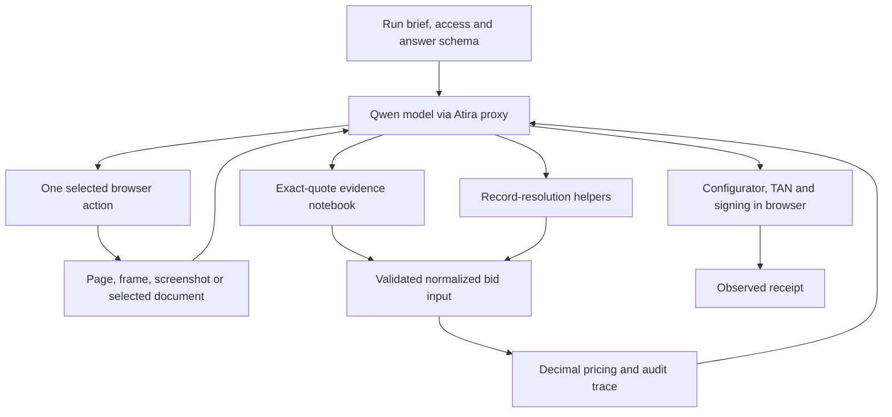

# RFQ agent implementation

This implementation targets the Atira RFQ **version 6** brief read on **2026-10-10**.
It provides a runnable model-directed browser agent, an evidence notebook, deterministic
record-resolution helpers, a Decimal pricing engine, tests, and a submission package builder.
It has passed local unit tests and a real Chromium/CDP smoke test. It has **not** completed
a public challenge rehearsal or received a challenge score.

The live run brief and answer schema are loaded at runtime. They remain authoritative.
Changes to business rules may require code changes; loading a newer brief alone does not
make an older calculator support new rules.

## Installation and local checks

Use Python 3.11+ locally; the challenge sandbox supplies Python 3.12 and uv.

```bash
uv venv .venv
uv pip install --python .venv/bin/python -e '.[test,rfq]'
.venv/bin/python -m pytest -q
.venv/bin/rfq-agent --help
```

The `rfq` extra adds httpx, Playwright, PyMuPDF and jsonschema. Importing the RFQ
calculator does not import browser/network dependencies. `requirements-rfq.txt` pins
the runtime dependencies used by `agent.json`. Refresh intentionally with:

```bash
uv pip compile pyproject.toml --extra rfq -o requirements-rfq.txt
```

The browser smoke test is opt-in because it starts a temporary local Chrome process:

```bash
RFQ_BROWSER_SMOKE=1 CHROME_BINARY=/opt/google/chrome/chrome \
  .venv/bin/python -m pytest -q tests/test_rfq_browser_smoke.py
```

It tests CDP attachment, observed control references, form entry, nested frames,
popups, a selected download and screenshots using invented HTML. It does not access
challenge websites. The test is excluded from the submission package. On hosts that
restrict local sockets or browser processes, it needs execution outside that restriction.

## Running against the practice websites

Install/sign in to the organizer's CLI using its official guide. In one terminal:

```bash
export ATIRA_API=https://ehl-challenge.atira.ai
atira login
atira models proxy
```

In another terminal, load the scouting configuration and attach an existing local browser:

```bash
export ATIRA_API=https://ehl-challenge.atira.ai
eval "$(atira scout --challenge rfq --env)"
# Start a dedicated local Chrome with debugging enabled, outside any challenge run:
google-chrome --remote-debugging-port=9222 --user-data-dir=/tmp/ehl-rfq-chrome
```

Then run from a terminal with the same scouting environment:

```bash
export CDP_URL=http://127.0.0.1:9222
.venv/bin/rfq-agent --prepare-only
# To let the agent fill, sign and submit on the practice site:
.venv/bin/rfq-agent
```

`--prepare-only` instructs the model not to enter a bid and ends the tool loop at the
first successful calculation. Browser exploration still uses clicks and form fills;
this is not a network-enforced read-only browsing mode.

The runtime never starts browsers itself, even locally. Inside the sandbox it attaches
only to the one to four local endpoints in `CDP_URLS` / `CDP_URL`. The current manifest
requests **one** browser; tabs are sufficient for the sequential initial agent. The
browser adapter supports four endpoints, but this implementation does not run parallel
investigation agents.

Required local inputs are `CHALLENGE_SCOUTING` (the CLI's JSON), `QWEN_BASE_URL`,
`QWEN_API_KEY`, and `CDP_URL` or `CDP_URLS`. In a test/scored run, the runtime instead
fetches `/v1/runs/current` using `CHALLENGE_API_URL` and `CHALLENGE_RUN_TOKEN`. Its Qwen
URL must be under `LLM_PROXY_URL`. No website credentials, tender values or answers are
embedded in the implementation or package.

## Packaging and rehearsals

```bash
.venv/bin/python scripts/package_rfq.py
# The directory below contains only the allowlisted package contents:
mkdir -p /tmp/ehl-rfq-package
tar xzf dist/rfq-agent.tar.gz -C /tmp/ehl-rfq-package
atira test-run /tmp/ehl-rfq-package --challenge rfq
```

After inspecting the rehearsal's score, browser recording and failure cases, the same
directory can be submitted using `atira submit /tmp/ehl-rfq-package --challenge rfq`.
No rehearsal or scored submission is started by the package builder.

The builder includes `agent.json`, `pyproject.toml`, `requirements-rfq.txt`, README,
this guide, and Python source. It excludes tests, synthetic fixtures, `.env`, repository
metadata, local databases, browser profiles and run artifacts. It rejects packages
over 20 MB compressed. `setup` installs the pinned runtime dependencies, then the
project; `run` invokes the installed module without downloading browser binaries.

## Architecture and execution



`runtime.py` supplies the instructions and tool schemas. Qwen chooses navigation,
search terms, relevant documents, the governing specification, authoritative messages,
and normalized business facts. There is no fixed site traversal or crawler. The runtime
does not use the toolkit's regex RFQ demo as a challenge solver.

`browser.py` attaches with Playwright's `connect_over_cdp`. It lists existing pages and
frames and exposes visible controls from the selected frame. Controls have temporary
references that expire after a mutation, including a timed-out mutation. The model must
observe again. It can page through long text and controls using offsets. This supports
model-directed pagination without independently discovering records.

Only run-provided site origins are allowed for browser requests. This can block an
unlisted external CDN or SSO origin; revise the policy based on an actual run contract,
not an unrestricted wildcard. The model has no arbitrary Python, shell, JavaScript,
filesystem or HTTP tool. The small DOM-reading JavaScript is fixed code.

Downloads occur only after the model selects an observed control. ZIP member names are
listed, then the model selects one to parse. Members are read in memory, never extracted
to arbitrary paths. PDF text and UTF-8 text/CSV/JSON/XML/HTML are supported. Downloads and
individual ZIP members have a 20 MiB read limit. This is a parsing limit, not an enforced
network transfer cap. Image-only PDFs need future OCR support.

`evidence.py` stores observation URL, timestamp, exact text and SHA-256. Citations must
quote a nonempty exact substring of a saved observation. The calculator checks that all
supplied evidence IDs exist. This verifies provenance links, **not** whether a quote
semantically establishes every normalized value. That still depends on model reasoning.

`runtime.py` validates the calculated answer against the live JSON Schema before the
model fills the portal. It does not submit RFQ answers via an invented API endpoint.
The model handles the signing/TAN workflow through ordinary observed browser controls.
`finish` requires a prior valid calculation and a quoted observation on the submission
origin. This records the model's receipt interpretation; it is not an independent proof
that the platform accepted or scored the bid.

## Business rules and input contract

`BidInput` in `models.py` is the precise input contract. The `calculate` tool exposes its
generated JSON Schema to the model. Unknown fields, non-finite decimals, invalid
quantities, duplicate position IDs, duplicate/unknown allocation members and reversed
price windows are rejected. Monetary inputs should be decimal strings. All business
fields are required, including explicit zeros, nulls and empty allocation lists where
evidence establishes absence. An omitted field is not silently priced as zero.

The normalized input is a boundary: the model must collect and resolve source records
before calling the calculator. The following division is deliberate:

| Concern | Implementation and remaining responsibility |
| --- | --- |
| Tender identity, scenario date, governing full revision | Model selects from observed sources; current-revision status must be verified. |
| Exact authority, reference, key and date | `authorized_record` filters selected normalized records and chooses the latest timestamp. The model derives the authorized sender and topic from the brief. |
| Conditional approvals | Select latest first; calculator checks the inclusive goods-value threshold. Failed conditions never revive old approvals. |
| Withdrawn quantities and set conversion | `final_quantity` removes withdrawn answers, chooses the newest remaining position change, then converts Satz to pieces. |
| Scoped technical amendments | `amended_requirement` applies latest changes per attribute for the named revision and requirement, then adds twice the reserve for usable stroke. The model supplies the revision-specific technical approval. |
| Metal-index validity | `window_rate` chooses the unique inclusive window in the model-selected latest authorized message. |
| Material matching | Calculator requires exact bore, stroke, pressure, mounting and certification, and active status. Numeric units must be normalized to mm/bar first. |
| Missing versus unresolved material | A complete catalogue result with no matching active material produces `no_bid`; `catalogue_complete=false` raises an unresolved-input error. The model must establish search completeness. |
| Price condition, scale and FX | Exactly one date-valid condition; highest reached per-position scale; normalize price unit, convert to EUR, HALF_UP to cents. Model resolves the correct FX-key rate. |
| Shared stock | Sum pieces for all positions using the same material. All use production unless total demand fits stock. Conflicting repeated material facts are rejected. |
| Delivery commitments | Override per position only when material matches and pooled demand is within the inclusive ceiling. |
| Commercial clauses | Model resolves prose to `base`, `base_and_mass` or `none`; no group means explicit `base`. Setup, packaging and bonus are excluded from percentage discount. |
| Cartons | Ceiling division independently per position; bid quantity stays unchanged. |
| Shared setup | Allocate one fee by quantity × allocation mass using largest remainder cents, ties by position string. Other mail-specified allocation algorithms are rejected, not guessed. |
| Project bonus | Apply marginal bands to eligible undiscounted EUR base goods, round aggregate credit, allocate by line goods with largest remainders. Nonmembers receive zero. |
| Final unit and order total | Unrounded per-piece components; HALF_UP final unit once; sum quantity × rounded final unit. |

Record helpers accept ISO dates or offset-aware timestamps. Timestamp ordering and
cutoff dates are normalized to UTC; callers must normalize business dates consistently
with the scenario before supplying them. Equal latest timestamps are treated as
ambiguous. Withdrawals must reference an earlier observed answer; withdrawal of a
withdrawal is rejected pending an explicit rule. These helpers do not discover records.

For each position, using `q` final pieces:

```text
base = HALF_UP(scale price / price-unit pieces × EUR per currency unit, cents)
mass = surcharge mass kg × date-valid metal rate EUR/kg
setup = ordinary setup fee + allocated shared setup fee
packaging = ceil(q / carton pieces) × carton tariff
final unit = HALF_UP(clause-discounted base + clause-discounted mass
                    + (setup + packaging − allocated position bonus) / q, cents)
total net = HALF_UP(sum(q × final unit), cents)
```

Reported `surcharge_per_unit` is the pre-discount mass surcharge plus setup divided by
pieces; it excludes packaging and bonus. `packaging_per_unit` is carton cost divided by
pieces. Both reports round to cents but never feed back into the final formula.
`rebate_total` is the credit for the entire position. Threshold goods value excludes
mass, setup and packaging and uses the converted, cent-rounded base prices. A no-bid
result with a conditional approval has zero discount; unconditional approval is retained.

The calculator returns `{answer, audit}`. The audit includes selected scale thresholds,
pooled demand, carton counts, full setup/packaging costs, commitment application, goods
total, bonus total and setup allocations. Decimal values are strings in local JSON
artifacts/tool responses so precision is retained; `wire_answer` converts the answer to
JSON numbers for schema validation and rejects lossy numeric conversions.

## Runtime limits and artifacts

The default wall-clock budget is 1,185 seconds and 250 model steps. A live `expires_at`
can shorten this further, with five seconds reserved before expiry. The async deadline
interrupts pending model/browser work. Navigation has a 15-second timeout; control
actions have an 8-second timeout. Model calls retry transient network/429/5xx failures up
to three attempts, under the outer deadline. Mutating browser actions are not blindly
retried: the model receives the error and must inspect current state.

Old interaction rounds are removed when serialized history exceeds 300,000 characters,
preserving whole tool-call/result groups. Evidence and notes remain available via
`notebook`. This is a character-based heuristic, not exact tokenizer budgeting.

Each tool step checkpoints `.rfq-artifacts/run.json` using atomic replacement. It contains
observations, citations, notes, last valid calculation input/output, and receipt, if any.
Known credentials and model/run keys are redacted. Files are mode 0600; the directory is
created mode 0700. Artifacts still contain business records and may contain TAN text:
keep them private. They are excluded from Git and the package. Checkpoints are for
inspection, not automatic resume; reusing a prior run's data would be incorrect.

Stdout contains only step/tool/status and final status. `prepared` means calculation
completed in prepare-only mode. `receipt_recorded` means the agent cited a receipt.
Neither status means a particular challenge score. A failure exits nonzero and reports
its exception type without exposing credential-bearing exception URLs.

## Test coverage

All rule fixtures are invented. Tests cover final prices and independent breakdowns,
each discount scope, threshold boundaries, currency/price units, no-bid versus unknown,
exact/ambiguous matches, shared stock versus per-position scales, delivery commitments,
setup conservation, marginal bonuses, tie-breaking, rounding feedback errors, invalid
inputs and conflicting records. Resolution tests cover withdrawals, set conversion,
scoped amendments, technical reserve, exact authority, decoys and index windows.

Runtime tests cover exact quotes, missing evidence, schema rejection, receipt-origin
checks, error recovery, prepare-only stopping, deadline interruption, transient proxy
retries, redaction, explicit ZIP selection and CDP-only browser attachment. The opt-in
real-browser test covers the browser integration separately from mocked model tests.

No unit test establishes live navigation quality, extraction accuracy, correct commercial
prose interpretation, private-dataset generalization or the 20-minute completion rate.

## Prioritized room for improvement

1. **Run a public rehearsal and inspect its breakdown.** The highest-value next step is
   finding actual navigation/document/interpretation failures. Record quality, end-to-end
   time, token usage and cost; do not optimize against invented accuracy numbers.
2. **Strengthen evidence validation.** Add field-level provenance and consistency checks
   linking each normalized amount, requirement, sender/date and catalogue-completeness
   assertion to the source. Verify the final form values and actual accepted receipt.
3. **Improve document interaction.** Add model-selected direct PDF-viewer retrieval, OCR
   for scanned PDFs, DOCX/XLSX parsing, shadow-DOM controls and screenshot coordinate
   actions. Currently image-only/custom canvas interfaces may block progress.
4. **Support more setup allocation rules.** Read and implement any other algorithms
   specified in pool emails, with tie and cent-conservation tests. Do not map unfamiliar
   prose to largest remainder automatically.
5. **Make deadline fallback operational.** The prompt explains portal omissions, but the
   calculator currently requires complete normalized positions and finish requires a
   valid calculation. Add a separate validated partial-bid representation and reserve
   explicit time for review/TAN/signing. Do not call omissions a complete solution.
6. **Use concurrent investigation when measured useful.** The adapter can attach four
   browsers, but investigation is sequential. Add coordinated model workers with a
   shared evidence store, independent page ownership and dependency-aware calculations.
7. **Control model context and observability.** Use tokenizer-aware history budgets,
   semantic evidence retrieval, per-call token/latency metrics and bounded screenshots.
   Add a durable action journal without recording secrets.
8. **Expand robustness tests.** Simulate session expiry, cookies, interrupted downloads,
   flaky navigation, prompt injection in business text, wrong dates/units, and receipt
   ambiguity across several unseen local site layouts. Pin/test build dependencies and
   the exact sandbox Chromium version as part of rehearsal reproducibility.

## Sources

- [RFQ challenge brief](https://ehl-challenge.atira.ai/challenges/rfq.md)
- [Run contract](https://ehl-challenge.atira.ai/docs/run-contract.md)
- [Fair-play rules](https://ehl-challenge.atira.ai/docs/fair-play.md)
- [Playwright CDP attachment](https://playwright.dev/python/docs/api/class-browsertype#browser-type-connect-over-cdp)
- [Playwright downloads](https://playwright.dev/python/docs/downloads)
